<div align="center">

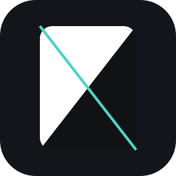

# Weiss Schwarz Deck Importer

**Recognize decks from images, explore cards, and build your own decks—all in one Windows app.**

[](#)
[](#)
[](#)
[](https://github.com/SamTheCoder777/WeissSchwarzDeckImporter/releases/latest)
[](https://discord.gg/vZGjQ2N8D6)

<br>

[Quickstart](QUICKSTART.md) &nbsp;•&nbsp; [Features](#features) &nbsp;•&nbsp; [Deck Builder](#deck-builder) &nbsp;•&nbsp; [Download](#download) &nbsp;•&nbsp; [FAQ](#faq) 

<br>

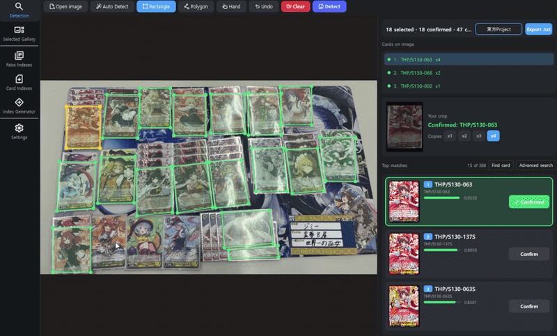

</div>


> [!IMPORTANT]
> **First time?** Start with the **[Quickstart guide](QUICKSTART.md)**
---

## Overview

**Weiss Schwarz Deck Importer** is a Windows desktop application for recognizing cards from deck images and building decks from scratch. Identify cards in screenshots or photos, review their details and English translations, then export or share your deck in the format you need.

Prefer to build a deck yourself? The integrated **Deck Builder** lets you browse English and Japanese cards, search and filter their abilities, organize your deck, and import or export deck lists.

Card information and translations are handled automatically, with [EncoreDecks](https://www.encoredecks.com/) available as an optional data source. Recognition libraries and required models are downloaded separately; once the necessary files are installed, card recognition can run locally. Some card details and images may still require an internet connection.

**Supported card languages:** English and Japanese  
**Supported platform:** Windows

For bug reports, feature requests, and community support, join the [Discord server](https://discord.gg/vZGjQ2N8D6).

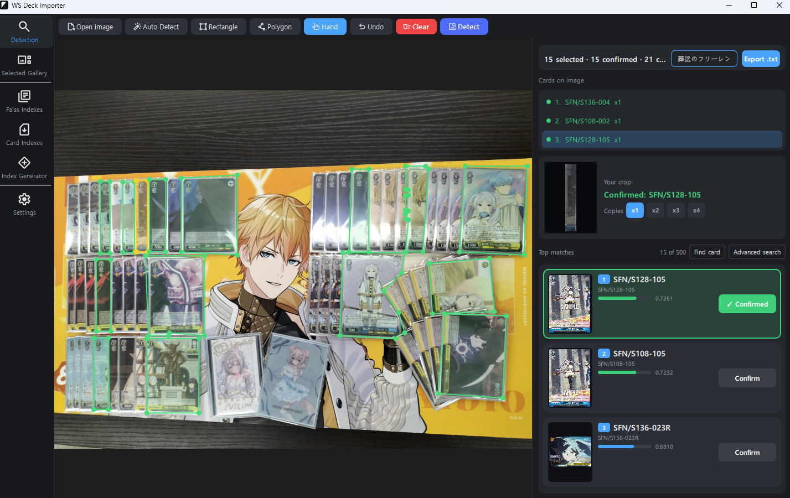

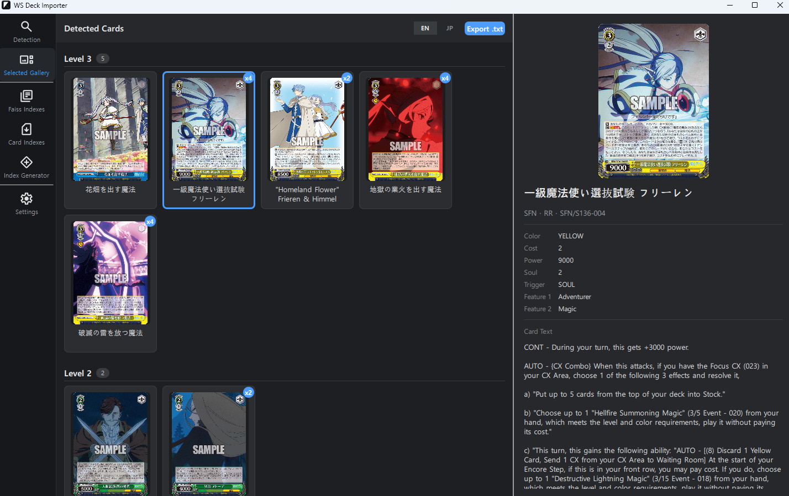

---

## Features

<table>
<tr>
<td width="45%">

### Automatic card detection

No need to outline every card by hand. Just click on a card and the auto-detect tool
outlines it for you.

</td>
<td width="55%">
  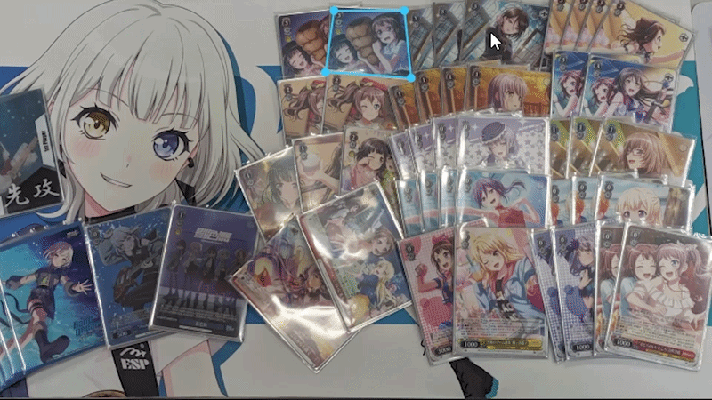
</td>
</tr>

<tr>
<td width="55%">
  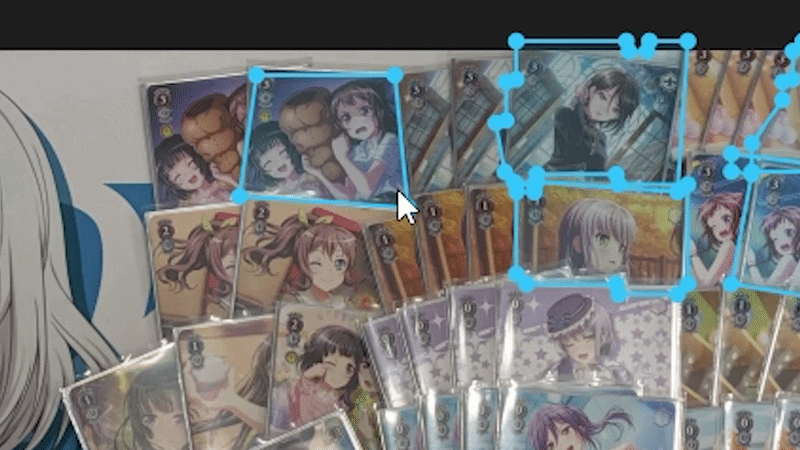
</td>
<td width="45%">

### Full control over your selections

Get every card framed exactly right. Adjust a selection by dragging its points, remove
points you don't need, and undo any change with full undo support.

</td>
</tr>

<tr>
<td width="45%">

### Verify before you confirm

For each card it identifies, you can check the source image against the matched card art
side by side. Catch any misreads and correct them, so the deck list you export is
actually the deck in the picture.

</td>
<td width="55%">
  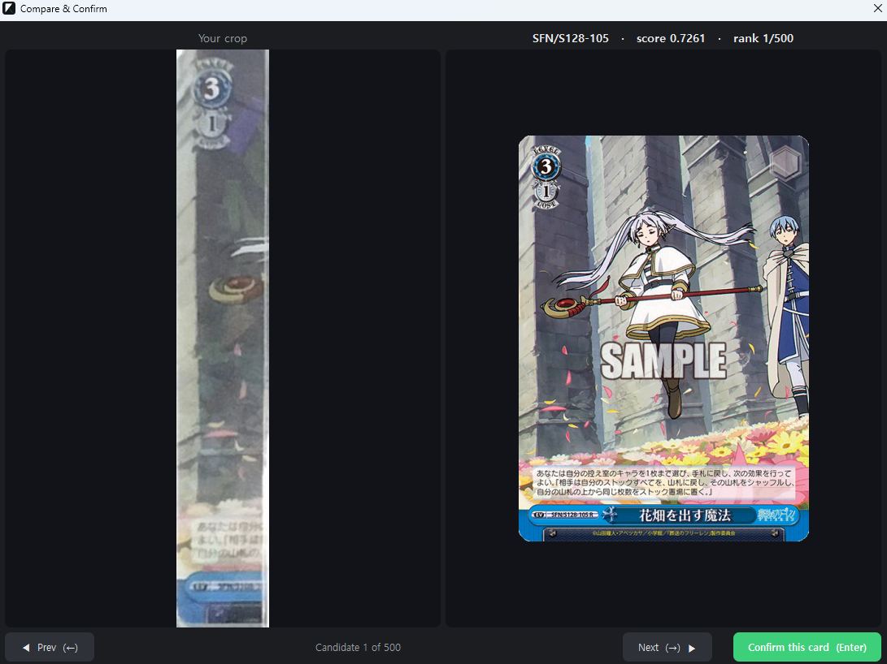
</td>
</tr>

<tr>
<td width="55%">
  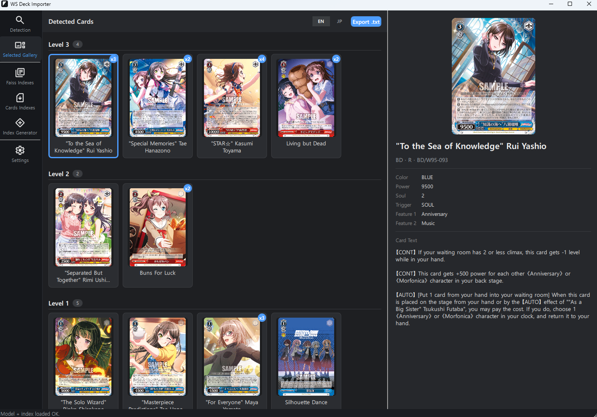
</td>
<td width="45%">

### Review cards and export your deck

Inspect the identified cards and their abilities, correct any mismatches, and export the result in the format that suits you:

- **PNG image** — generate a shareable picture of the deck.
- **Share code** — send a code that another app user can open to view the deck immediately.
- **TXT deck list** — export a text file compatible with the app and the **Enhanced Weiss Schwarz Simulator**.

</td>
</tr>
</table>

<!-- SCREENSHOT: Exported deck image. Replace this comment with:
<p align="center"></p>
Capture the final PNG output itself, rather than only the export dialog.
-->

---

## Deck Builder

Build, explore, and manage decks directly in the app—no deck image required. Browse **English and Japanese cards**, refine your search, and move seamlessly between your collection and the deck you are building.

<p align="center">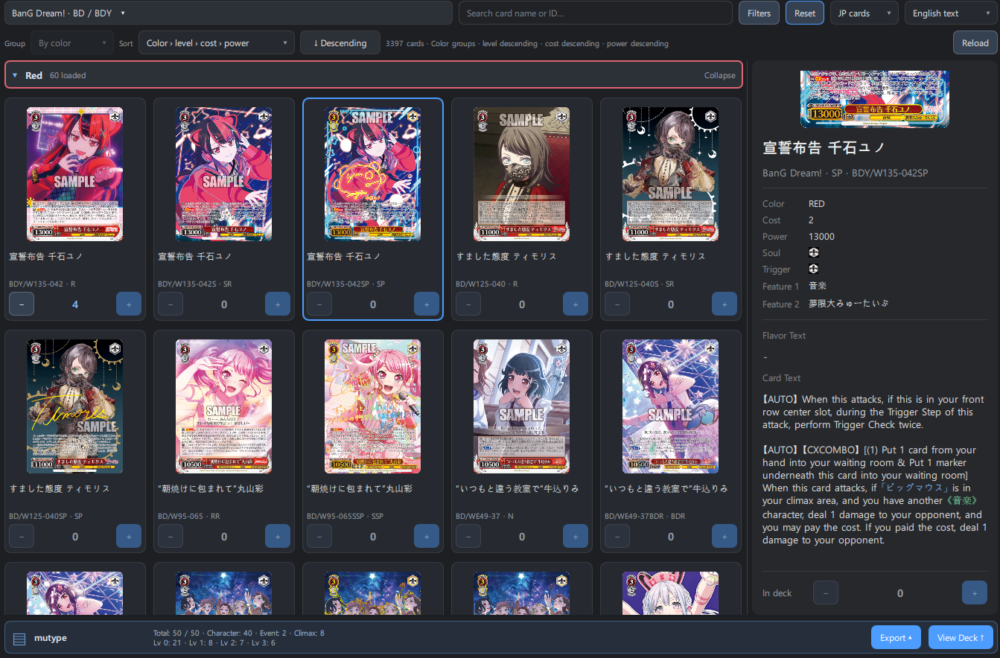</p>

<table>
<tr>
<td width="45%">

### Find exactly the cards you need

Use **advanced search** to narrow the card catalog, then apply **multiple grouping and sorting options** to browse the results more efficiently. Search across both English and Japanese cards.

</td>
<td width="55%">

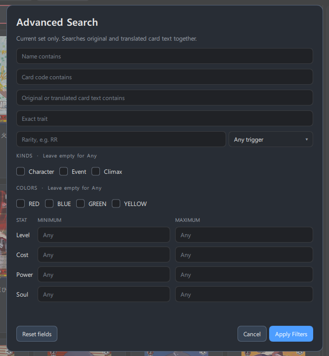

</td>
</tr>
<tr>
<td width="55%">

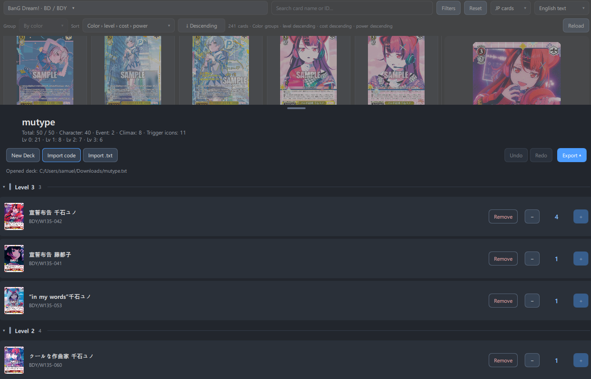

</td>
<td width="45%">

### Keep your deck within reach

Open the **bottom drawer** for a quick view of your current deck without leaving the card browser. When you need a closer look, use the **dedicated deck gallery** to review all selected cards in a large grid.

</td>
</tr>
<tr>
<td width="45%">

### Explore connected cards

Card text is interactive. Click a **card name, trait, or ability** to find cards matching that reference, making it easier to discover relevant cards while building.

</td>
<td width="55%">

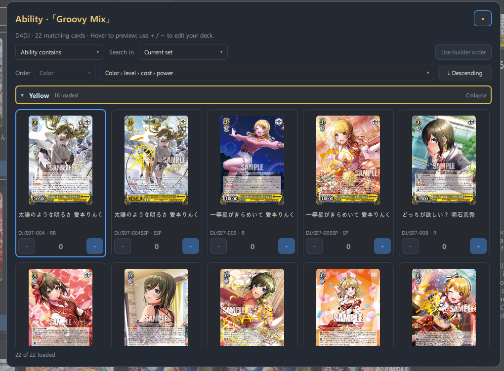

</td>
</tr>
<tr>
<td width="55%">

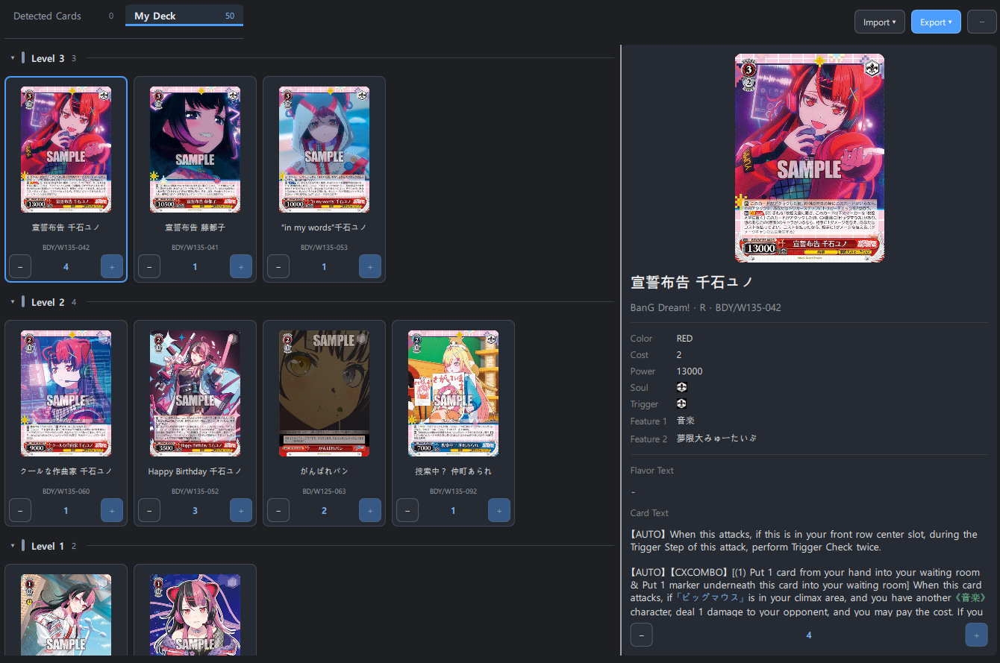

</td>
<td width="45%">

### Review the complete deck

Switch to the **dedicated deck view** to inspect the full deck in a spacious card grid, separate from the regular card browser.

</td>
</tr>
</table>

### Import, export, and share

Bring existing deck lists into the Deck Builder or share your work in the format that suits you.

| Format | Supported workflow |
|---|---|
| **Share code** | Export a code that another app user can open to view the deck immediately. |
| **PNG image** | Export a picture of the deck for sharing. |
| **TXT deck list** | **Import** supported **EncoreDecks** and **Enhanced Weiss Schwarz Simulator** deck lists; **export TXT** for the **app** or the **Enhanced Simulator**. |

<p align="center"><i>PNG Export Example</i></p>

<p align="center">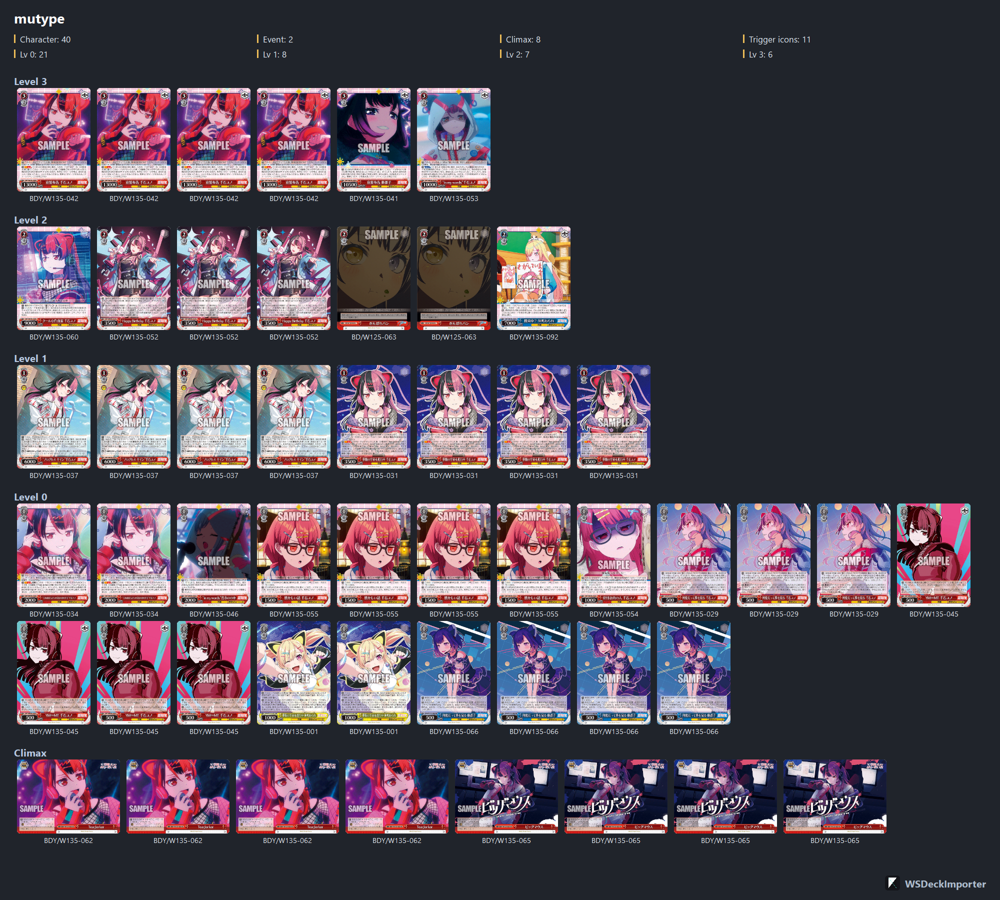</p>


---

## Card libraries and data

<table>
<tr>
<td width="55%">
  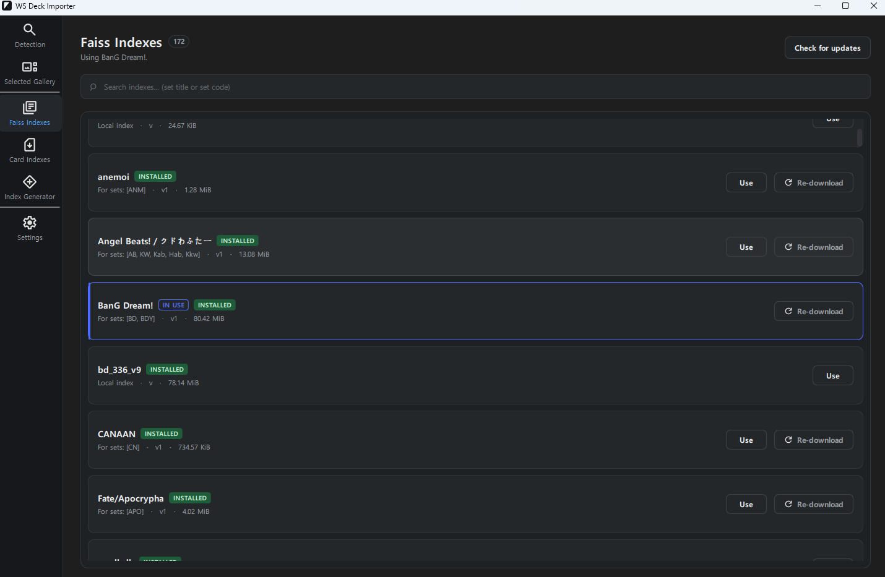
</td>
<td width="45%">

### Recognition libraries

The app identifies cards using **recognition libraries** (FAISS indexes). Download the libraries for the sets you want to recognize and manage them in the app. Recognition libraries are separate from the card details and translations retrieved automatically.

</td>
</tr>
<tr>
<td width="45%">

### Automatic card details and translations

Card information is retrieved automatically, including **English translations for Japanese cards**. You no longer need to manually install card-data sets before viewing identified cards. [EncoreDecks](https://www.encoredecks.com/) remains available as an optional source.

</td>
<td width="55%">
  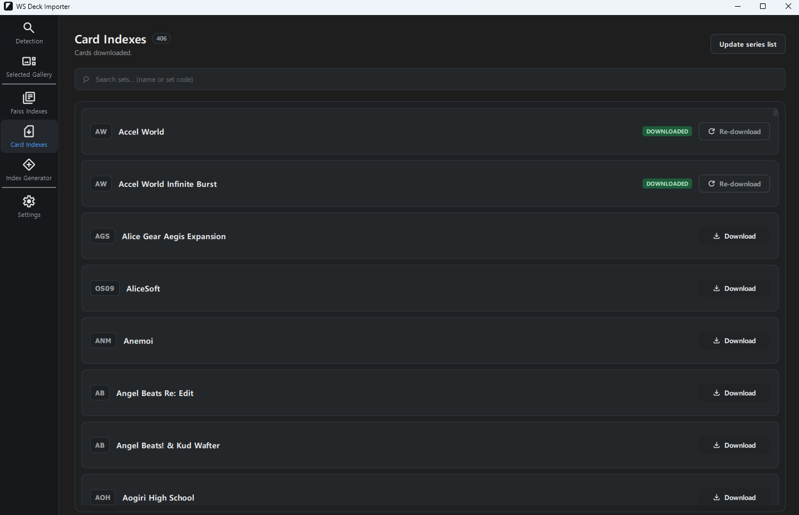
</td>
</tr>
</table>

---

## Required models

Recognition uses two ONNX models, distributed separately from the application. Download both from Hugging Face and select them in the app settings on first launch.

<table>
<tr>
<td width="50%">

### [Card Identifier](https://huggingface.co/SamTheCoder777/Card_Identifier)

Recognizes card artwork in an image. Fine-tuned from **[DINOv3](https://huggingface.co/facebook/dinov3-vitl16-pretrain-lvd1689m)**.

**[Download Card Identifier](https://huggingface.co/SamTheCoder777/Card_Identifier/resolve/main/card_identifier.onnx?download=true)**

</td>
<td width="50%">

### [Card Detector](https://huggingface.co/SamTheCoder777/Card_Detector)

Locates cards in an image to support automatic selection. Based on **[YOLOv8](https://huggingface.co/Ultralytics/YOLOv8)**.

**[Download Card Detector](https://huggingface.co/SamTheCoder777/Card_Detector/resolve/main/card_detector.onnx?download=true)**

</td>
</tr>
</table>

> The model files have their own licenses. See the respective Hugging Face pages for details.

---

## Download

Download the latest **Windows** release from the [Releases page](https://github.com/SamTheCoder777/WeissSchwarzDeckImporter/releases). Extract the ZIP archive and launch `WSDeckImporter.exe`.

For setup instructions, including the required models and recognition libraries, see the [Quickstart guide](QUICKSTART.md).

---

## FAQ

<details>
<summary><b>What kinds of images can I use?</b></summary>
<br>

The recognition workflow is designed for deck-list screenshots and photos, including images with partially obscured cards, glare, or foil reflections. Recognition accuracy can vary with image quality and how much of each card is visible.
</details>

<details>
<summary><b>Do I need to download card data for each set?</b></summary>
<br>

No. Card details and English translations are handled automatically. Recognition libraries are separate from card details: you still need the relevant recognition library to identify cards from an image.
</details>

<details>
<summary><b>Can I use EncoreDecks card data?</b></summary>
<br>

Yes. EncoreDecks remains available as an optional card-data source.
</details>

<details>
<summary><b>Does the app work offline?</b></summary>
<br>

Card recognition can run locally after the required models and recognition libraries are installed. Some card details, artwork, and updates require internet access, so complete offline access to every card's information is not guaranteed.
</details>

<details>
<summary><b>Which deck formats can I import or export?</b></summary>
<br>

The Deck Builder supports share codes, PNG deck images, and TXT deck lists for sharing or export. It can import EncoreDecks and Enhanced Weiss Schwarz Simulator TXT deck lists, and export TXT for use in the app or the simulator. Share codes let other app users open a deck quickly.
</details>

<details>
<summary><b>Which platforms are supported?</b></summary>
<br>

Windows is the supported release platform.
</details>

<details>
<summary><b>Is this an official Weiss Schwarz product?</b></summary>
<br>

No. This is an independent, non-commercial fan project. It is not affiliated with or endorsed by Bushiroad.
</details>

---

<div align="center">

## For developers and contributors

Want to look under the hood or help out? The details are below.

</div>

<details>
<summary><b>Tech overview</b></summary>
<br>

A native **C++ / Qt 6** desktop application. 

- A **fine-tuned DINOv3 ViT-L/16** vision backbone encodes a card image into an embedding vector, trained so a real-world image lands near that card's master image in embedding space.
- **FAISS** performs fast approximate nearest-neighbour search over the library of card embeddings.
- Inference runs through **ONNX Runtime**, with DirectML acceleration available on supported Windows hardware.

| Layer | Technology |
|---|---|
| Recognition model | DINOv3 ViT-L/16 (fine-tuned) → ONNX |
| Inference | ONNX Runtime (DirectML / CPU) |
| Search | FAISS |
| Application | C++20, Qt 6 (Widgets + QML) |
| Image processing | OpenCV |
| Local storage | SQLite |

</details>

<details>
<summary><b>Building from source</b></summary>
<br>

**Prerequisites (Windows):** Qt 6 (6.11+), CMake 3.24+, a C++20 compiler, ONNX Runtime, FAISS, and
OpenCV. [vcpkg](https://github.com/microsoft/vcpkg) is the easiest way to manage dependencies.

```bash
# Windows
cmake -B build -DCMAKE_BUILD_TYPE=Release \
  -DCMAKE_TOOLCHAIN_FILE=<vcpkg>/scripts/buildsystems/vcpkg.cmake
cmake --build build --config Release
```

> Build in **Release** for normal performance. Ensure the required ONNX Runtime,
> OpenCV, and FAISS libraries are available at runtime.

</details>

<details>
<summary><b>Contributing</b></summary>
<br>

Contributions are welcome. Open an issue to discuss an idea, or submit a pull request.

</details>

---

## Acknowledgements

- **[EncoreDecks](https://www.encoredecks.com/)** — Optional card-data source and deck-list import compatibility
- **[Official Weiss Schwarz Card List](https://ws-tcg.com/cardlist/)** — Official card information
- **[DINOv3](https://github.com/facebookresearch/dinov3)** by Meta AI — the vision backbone (used under the DINOv3 license)
- **[YOLOv8](https://huggingface.co/Ultralytics/YOLOv8)** by Ultralytics — detects card outlines
- **[FAISS](https://github.com/facebookresearch/faiss)** — nearest-neighbour search
- **[ONNX Runtime](https://onnxruntime.ai/)** — model inference
- **[Qt](https://www.qt.io/)** — application framework

---

## Legal

This is a non-commercial, fan-made project. Weiss Schwarz, all associated card names,
artwork, and text are trademarks and copyrights of Bushiroad and its respective licensors.
This project is **not affiliated with, endorsed by, or sponsored by Bushiroad**.

Card artwork and card data remain the property of their respective rights holders.
The application does not bundle official card images; artwork may be retrieved from
third-party sources when needed.

The source code of this project is licensed under the GNU Affero General Public License
v3.0. This license applies only to the code itself. It does not grant any rights to
Weiss Schwarz card data, artwork, or trademarks.
